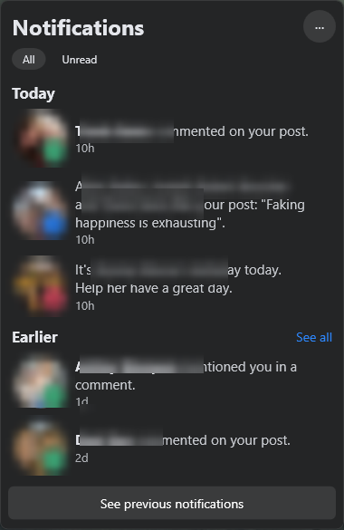
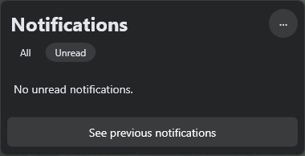
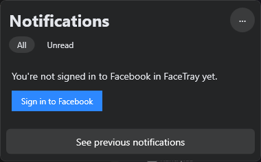
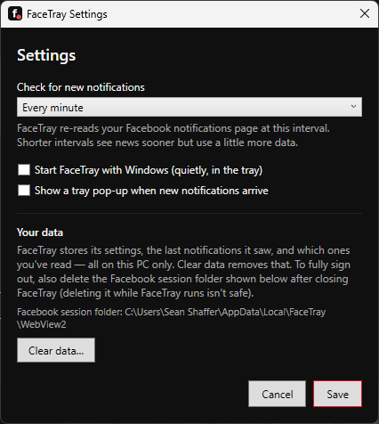

# FaceTray

## TL;DR

FaceTray puts your Facebook notifications in the Windows system tray. The tray icon shows a red counter bubble with how many unread notifications you have; click it and a ticker pops up that looks like Facebook's own notifications menu — latest notifications, grouped into Today and Earlier. Click any notification and it opens in your default browser. You sign in once, inside FaceTray, and it stays signed in. Multiple Facebook accounts are supported, each with its own sign-in. Pins, folded repeats, keyboard triage, per-type alert rules, a full local backup, portable mode and an ARM64 build are in too.

## Features

- **Live counter on the tray icon** — re-rendered at runtime (1–9, then `9+`; no bubble at zero). The tooltip says “FaceTray — 3 unread”.
- **Facebook-style ticker** — 380px dark panel (`#242526`), “Notifications” header with a `···` menu, All / Unread filter pills, Today / Earlier sections, 56px circular avatars (stacked, up to three, on group notifications) with a coloured type badge (green speech bubble for comments and mentions, blue thumbs-up for likes, pink cake for birthdays, grey bell otherwise), relative times, a blue dot on unread rows, and the “See previous notifications” footer button.
- **Click a notification → your default browser**, at that notification's exact Facebook link. It is marked read locally at once, so the counter drops immediately.
- **Reading tools** — search box (person or text), Settings type filters (hide likes, birthdays, … from ticker *and* counter), hover ✓ to mark one notification read without a browser trip, snooze for 1 hour or until tomorrow, and a 100-notification history with “Show more”.
- **Pins & folded repeats** — pin a notification and it lives in a Pinned section above Today, safe from the history prune. Repeat notifications about the same post fold into one row with a ×N chip — click it to expand them inline.
- **Keyboard triage** — with the ticker open: `j`/`k` move, Enter opens, `m` marks read, `s` snoozes an hour, `p` pins, `x` expands a fold. “Mark all read” offers an Undo in the footer, and the `···` menu can open every unread notification in your browser at once.
- **Exact-time tooltips** — hover a row and, when Facebook exposes a machine-readable time for it, the tooltip shows the exact time (“Wed 21 Oct 2026, 16:32 (3h ago)”). The footer always shows how fresh the list is.
- **Multiple accounts** — up to 8 Facebook accounts, each with its own sign-in session, history, and **tray bubble colour**, so the tray tells you which account has news; switch from Settings (FaceTray restarts into the chosen account). The tray menu names the active account when you have more than one.
- **Alerts your way** — a rich pop-up card for new notifications (avatar, text, click to open), an optional sound, quiet hours that mute both overnight, and a tray menu that lists the 5 most recent notifications. **Ctrl+Shift+F** pops the ticker from anywhere.
- **Alerts that respect you** — per-type alert rules (pop-ups only for the kinds you choose), Windows Focus Assist / presentation / fullscreen suppression, exactly one gentle re-alert for a comment or mention left unread for 30 minutes, and an optional morning digest that summarises the night in a single pop-up.
- **Right-click tray menu** — Open Facebook, Notifications page, recent notifications, Refresh Now, Mark all read, Pause/Resume polling, Settings, Exit. A second launch of FaceTray toggles the ticker instead of starting a copy.
- **Adjustable, adaptive polling** — every 30 seconds, minute, 2 minutes or 5 minutes (Settings); checks sooner while unread wait, slower when quiet. Optional Start with Windows (off by default, starts quietly in the tray).
- **Self-defence** — three semantic extraction strategies tried in order (so one Facebook layout change has to break all three), an extraction-health warning banner, session-state detection that tells a “confirm it's you” checkpoint apart from a sign-out, a hidden view that rebuilds itself after a crash, an update notifier (checks GitHub once per launch, can be turned off), a diagnostics panel in Settings (versions and counts only), and settings export/import for moving PCs.
- **Backup & restore** — one backup file with the settings plus every account's read marks, snoozes, pins and cached notifications; restore it on any PC (FaceTray restarts to apply). Backups never contain a Facebook sign-in.
- **Ticker themes & text size** — Facebook dark, Light, or Follow Windows (including high-contrast system colours), plus 100/125/150% ticker text.
- **Forgiving states** — sign-in prompt when you're signed out, “You're all caught up”, the last-good list stays on screen when you're offline, and a plain-language error with Retry when a load fails.

## Install

Prerequisite: Microsoft's **WebView2 Runtime** (most Windows 10/11 PCs already have it — MuseDesktop uses the same one). FaceTray is a self-contained publish, so no .NET install is needed.

- **Portable ZIP:** unzip anywhere and run `FaceTray.exe`. Builds exist for **x64** and **ARM64** Windows — pick your machine's architecture.
- **Installer:** `FaceTray-Setup-v0.3.0-x64.exe` (or `-arm64` on ARM64 Windows; per-user, no admin; built with `installer/FaceTray.nsi` from the staged publish). Uninstall keeps your data unless you answer Yes to the “also delete” prompt.

Unsigned, like SEAN's other plain-EXE releases — Windows SmartScreen may warn on first run.

## Portable mode

FaceTray normally keeps its data in `%APPDATA%\FaceTray` and `%LOCALAPPDATA%\FaceTray`. To carry it on a USB stick instead: create an empty file named **`portable.txt`** in the same folder as `FaceTray.exe`, and FaceTray keeps *everything* — settings, history, and the Facebook sign-in sessions — in a `FaceTray-data` folder beside the executable. The marker file is yours to create; it is never included in the downloads. Delete it and FaceTray goes back to the AppData folders (the two sets of data never merge).

## How it works

There is no working official API for personal Facebook notifications (the Graph API notifications endpoint was removed by Meta years ago), so FaceTray does what your browser does:

1. On first run, a sign-in window opens on facebook.com inside FaceTray's own WebView2 profile (`%LOCALAPPDATA%\FaceTray\WebView2`). Sign in there once, including any two-factor step. FaceTray never sees or stores your password — the session lives in that profile, exactly like a browser's.
2. A hidden WebView2 page re-reads `facebook.com/notifications` at your chosen interval. A small script picks out the notification rows using semantic signals only — links, accessible labels, roles and visible text — never Facebook's internal styling class names, which change without notice.
3. The unread count is cross-checked against the count Facebook puts in the page title (`(3) Facebook`), so if the row reading ever misses, FaceTray degrades to showing the correct count instead of a wrong zero.

## Privacy

Local-only. No telemetry, no third-party servers, no token extraction — nothing leaves your PC except Facebook itself, over the same connection your browser would make, plus one optional exception: once per launch FaceTray can ask GitHub's API whether a newer FaceTray exists (turn it off in Settings → Updates; nothing is ever downloaded automatically). Settings, the last-seen notification list and your local read marks live in `%APPDATA%\FaceTray` as plain JSON; the diagnostic log (`%APPDATA%\FaceTray\logs\facetray.log`) records hosts and paths only, never full URLs, page content, cookies or tokens. Settings → Clear data wipes the active account's local cache, read marks, snoozes and pins; Settings → Back up everything… writes one JSON with the settings and local state for every account — it never includes the WebView2 sign-in sessions, so a backup can never sign anyone in. The Settings window also shows the session folder path if you ever want to delete it (while FaceTray is closed) to sign out completely.

## Honest limitation

FaceTray reads Facebook's web UI, so a Facebook layout change can break the ticker's list until the extraction script is updated — the title-count fallback is the safety net for the counter. See [KNOWN_LIMITATIONS.md](KNOWN_LIMITATIONS.md) for the full, current list.

## Screenshots

Captured from real runs on SEAN's Windows machine — no placeholders. Names and profile photos in the ticker shot are blurred for privacy; everything else is exactly as the app renders it.

The ticker, signed in (real notifications from the v0.1.1 field run):



The Unread filter, with nothing unread:



The ticker before sign-in — the first thing a new user sees:



Settings:



Still to capture:

1. Tray icon at 0 / 3 / 9+ unread (taskbar corner, 200% crop)
2. Login window

## Building

```powershell
dotnet build FaceTray.sln -c Release
dotnet test tests/FaceTray.Core.Tests -c Release   # full suite, never a filtered subset
dotnet publish src/FaceTray/FaceTray.csproj -c Release -r win-x64 --self-contained true -o publish/win-x64
dotnet publish src/FaceTray/FaceTray.csproj -c Release -r win-arm64 --self-contained true -o publish/win-arm64
```

Layout: `src/FaceTray.Core` is pure, testable logic (.NET 10, no Windows APIs); `src/FaceTray` is the WPF shell. CI (`.github/workflows/ci.yml`) builds, tests, publishes and runs the app's `--smoke-test` mode on Windows — on x64 and ARM64 runners alike.

## License

MIT — see [LICENSE](LICENSE). Copyright (c) 2026 Sean Shaffer.
